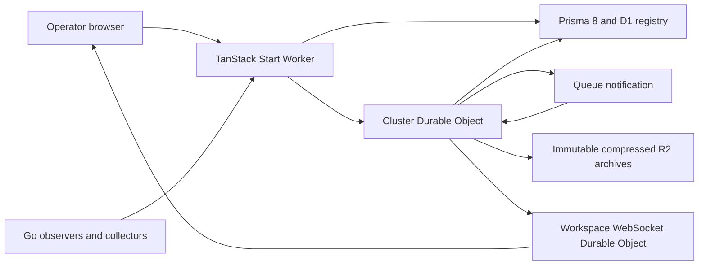

# Architecture

The hub is one full-stack TanStack Start Cloudflare Worker. UI operations pass
through validated server functions, middleware, actions and scoped data access.
Machine endpoints preserve the Go agent's HTTP and OTLP protobuf protocol.
Fumadocs runs in a separate Worker.

D1 stores workspace and cluster identities, credential verifiers and archive
indexes. A cluster Durable Object owns current inventory, profiles,
acknowledgments, latest series, deduplication and the archival outbox. Its native
SQLite transaction is the acceptance boundary. OTLP responses are actual
protobuf acknowledgments, including partial rejection counts.

Closed five-minute partitions are archived per entity. Objects are immutable
and content checked. D1 exposes the index after upload succeeds. Outbox samples
are removed after raw and summary objects and indexes commit. Generation checks
preserve concurrent late arrivals. Alarms retry independently of queue delivery.

Source nanoseconds and int64 values stay strings or BigInt. Semantic series
identity excludes only the per-sample source window. Original attributes,
resource and scope remain available in raw history and exports.

Workspace notification objects use WebSocket hibernation. Reconnecting clients
resynchronize saved scoped state; periodic queries cover missed notifications.
The hub needs no provisioned application server, Redis or PostgreSQL.

Go handles Kubernetes identity checks, TokenReview, the dedicated token audience,
node collectors, local Diagnostic expiry and bounded buffering. The monitoring
control API cannot execute shell commands or modify infrastructure.
